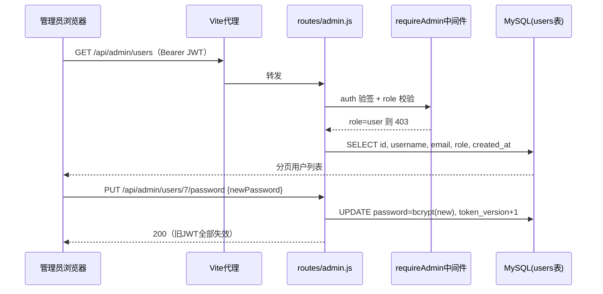

# 管理员用户管理（Admin User Management）

Feature Name: admin-user-management
Updated: 2026-10-19

## Description

为随手记应用引入管理员角色。管理员可管理其他**普通用户**的个人资料（查看列表/详情、编辑 username/email、重置密码），本期对其他用户的事件、统计、AI 数据零访问。重置密码后该用户全部旧登录态立即失效。

## Architecture



## Components and Interfaces

### 1. 数据迁移脚本 `scripts/migrate-admin-role.js`

- `users` 表新增 `role ENUM('user','admin') NOT NULL DEFAULT 'user'`
- `users` 表新增 `token_version INT NOT NULL DEFAULT 0`
- 幂等：存在即跳过；执行后支持 `--set-admin <email>` 一次性提升指定用户为 admin

### 2. 中间件 `middleware/admin.js`（新建）

```js
// 置于 auth 之后：req.user.role !== 'admin' → 403「无权限访问」
const requireAdmin = (req, res, next) => { ... }
```

### 3. 路由 `routes/admin.js`（新建，挂载 `/api/admin`）

| 方法 | 路径 | 功能 | 备注 |
|---|---|---|---|
| GET | /users | 列表，`page/pageSize/keyword` | keyword 模糊匹配 username 或 email；默认 pageSize=10，合法值 `[10,20,50,100]`（对齐 Events 约定） |
| GET | /users/:id | 详情 | 目标 role=admin → 403 |
| PUT | /users/:id | 编辑资料（username/email） | 校验规则与注册一致；冲突 → 400 |
| PUT | /users/:id/password | 重置密码 `{ newPassword }` | bcrypt(10)；`token_version + 1` |

挂载位置：`app.js` 中 `app.use('/api/admin', require('./routes/admin'))`，位于 rate limiter 之后。

### 4. auth 中间件增强 `app.js`

- 验签后比对 `decoded.tv === user.token_version`（兼容存量 token：`decoded.tv` 缺失且 `token_version=0` 时放行）
- 不等 → 401「登录状态已失效，请重新登录」（覆盖重置密码踢下线）

### 5. 前端

- `views/AdminUsers.vue`（新建）：复用 Profile/Events 的表格风格；资料编辑对话框；重置密码对话框（两次输入新密码 + 强度提示）；管理员行操作按钮置灰 + tooltip
- `router/index.ts`：`/admin/users` 路由 + `beforeEnter` 守卫（userStore.role 非 admin → 重定向 `/events`）
- `stores/user.js`：登录/获取资料响应新增 `role`、`tokenVersion` 字段
- `components/Layout.vue`：`v-if="userStore.role === 'admin'"` 显示「用户管理」菜单（Setting 图标）
- 编辑入口对「自己/其他管理员」置灰 + tooltip（复用 Profile 的禁用按钮模式）

## Data Models

```
users 表新增：
  role          ENUM('user','admin') NOT NULL DEFAULT 'user'
  token_version INT NOT NULL DEFAULT 0

JWT payload 新增：tv = user.token_version（存量 token 无 tv 字段，兼容规则见上）
```

## Correctness Properties

- P1: 全部事件/统计/AI 接口返回的数据恒满足 `userId === req.user.userId`（本期无任何例外接口）
- P2: `role=user` 请求任意 `/api/admin/*` → HTTP 403
- P3: 重置密码后，目标用户旧 JWT（任意设备）验证 → HTTP 401
- P4: 管理员对 `role=admin` 目标的读详情/写资料/重置密码 → HTTP 403
- P5: username/email 唯一性约束在任何入口（注册/个人资料/管理员编辑）保持一致

## Error Handling

| 场景 | 状态码 | 响应 |
|---|---|---|
| 普通用户访问管理接口 | 403 | `{ message: '无权限访问' }` |
| 目标为管理员 | 403 | `{ message: '仅可管理普通用户' }` |
| username/email 冲突 | 400 | `{ errors: [{ msg: '用户名已存在' }] }`（对齐现有格式） |
| 新密码不满足 ≥6 字符 | 400 | validator 消息 |
| 重置密码后旧 token | 401 | `{ message: '登录状态已失效，请重新登录' }` |
| 目标用户不存在 | 404 | `{ message: '用户不存在' }` |

## Test Strategy

1. 迁移脚本幂等执行两次，检查字段与首个 admin 设置
2. API 实测（沿用 sandboxtest + 新建测试用户）：
   - user 角色访问 → 403；admin 访问 → 200
   - 列表分页/keyword 搜索边界（空页、超大 page）
   - 编辑冲突用户名 → 400；编辑 admin → 403
   - 重置密码后旧 token 访问 → 401，新密码登录 → 200
   - admin 自身 events 接口数据隔离（P1 回归：管理员查自己事件，确认无越权通道）
3. 前端 `vue-tsc` 类型检查 + 路由守卫手测

## Out of Scope

- 查看/检索/导出他人事件、统计、AI 数据
- 禁用账号、删除用户
- 审计日志、多级角色

## References

- 现有 auth 中间件：backend/app.js（JWT 校验与 req.user 注入）
- 现有密码规则：backend/routes/auth.js:13（isLength min 6）
- 既有表格/对话框风格：frontend/src/views/Profile.vue
