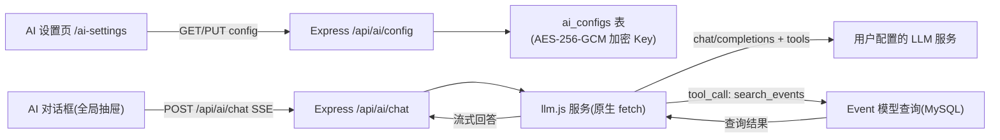

# AI 事件查询（Function Calling）

Feature Name: 2026-10-17-ai-event-query
Updated: 2026-10-17

## Description

为随手记接入 OpenAI 兼容 LLM 服务，先期实现自然语言查询本人事件。后端作为 LLM 代理：保存加密配置、维护工具调用循环、流式转发回答。前端提供 AI 设置页与全局对话框。

## Architecture



调用链：用户发送消息 → 后端组装 messages（system 提示词 + 最近 10 条历史 + 用户消息）与 tools 定义 → 调用 LLM。若 LLM 返回 `tool_calls`，后端执行 `search_events` 查询，将工具结果以 `role=tool` 消息追加后再次调用 LLM（最多循环 3 轮），最终回答以 SSE 流式转发给前端。

## Components and Interfaces

### 后端

| 文件 | 职责 |
|---|---|
| `backend/models/AiConfig.js` | ai_configs 表模型 |
| `backend/routes/ai.js` | GET/PUT `/api/ai/config`、POST `/api/ai/config/test`、POST `/api/ai/chat`（SSE） |
| `backend/services/llm.js` | LLM 客户端：组装请求、SSE 解析、工具调用循环（原生 fetch，零新依赖） |
| `backend/utils/crypto.js` | AES-256-GCM 加解密，密钥取 `process.env.AI_ENCRYPT_KEY` |
| `backend/app.js` | 挂载 `/api/ai` 路由（限流之内） |

### 工具定义（search_events）

```json
{
  "type": "function",
  "function": {
    "name": "search_events",
    "description": "查询当前登录用户的事件列表",
    "parameters": {
      "type": "object",
      "properties": {
        "keyword":   { "type": "string", "description": "标题/内容关键词" },
        "startDate": { "type": "string", "description": "开始日期 YYYY-MM-DD，事件开始日期不早于该值" },
        "endDate":   { "type": "string", "description": "结束日期 YYYY-MM-DD，事件结束日期不晚于该值" },
        "typeLevel1":{ "type": "string", "description": "一级分类，如 工作/生活/学习" },
        "status":    { "type": "string", "enum": ["进行中", "已完成", "已取消"] },
        "limit":     { "type": "integer", "description": "返回条数上限，默认 20，最大 50" }
      }
    }
  }
}
```

执行逻辑复用 `Event.findAll`：`userId` 强制注入，`typeLevel1` 映射列 `type_level1`，返回 id/title/typeLevel1/status/startDate/endDate。

### 前端

| 文件 | 职责 |
|---|---|
| `frontend/src/views/AiSettings.vue` | AI 配置表单（Base URL/Key/模型名）+ 测试连接 |
| `frontend/src/components/AiChat.vue` | 悬浮球 + `el-drawer` 抽屉聊天（消息列表、流式渲染、工具结果事件列表） |
| `frontend/src/components/Layout.vue` | 挂载 AiChat 悬浮球（桌面与移动端均显示） |
| `frontend/src/router/index.js` | 注册 /ai-settings；侧栏新增「AI 设置」入口 |

SSE 消息格式（`data:` 行 JSON）：
- `{"type":"delta","content":"..."}` — 增量文本
- `{"type":"tool","events":[...]}` — 工具命中事件列表（渲染用）
- `{"type":"done"}` / `{"type":"error","message":"..."}` — 结束/出错

## Data Models

```
ai_configs
  user_id    INTEGER PK (FK users.id)
  base_url   VARCHAR(255) NOT NULL
  api_key_enc TEXT NOT NULL        -- AES-256-GCM 密文 (iv:tag:ciphertext 十六进制)
  model      VARCHAR(100) NOT NULL
  createdAt / updatedAt       DATETIME
```

`backend/.env` 新增 `AI_ENCRYPT_KEY`（32 字节 hex，占位生成）；`.env.example` 同步占位符。

## Correctness Properties

1. search_events 查询始终携带 `userId = req.user.userId`，工具参数中的任何用户标识字段被忽略。
2. 数据库中仅存在 API Key 密文；config 读取接口只返回 Key 末 4 位。
3. 工具调用循环最多 3 轮，超出后系统直接要求 LLM 基于已有结果作答，防止死循环。
4. 对话请求在配置缺失时返回 409，前端据此引导跳转设置页。

## Error Handling

| 场景 | 处理 |
|---|---|
| LLM 401/403 | SSE error 消息「API Key 无效或无权限」 |
| LLM 404 | 「Base URL 或模型名不正确」 |
| LLM 429 | 「LLM 服务限流，请稍后重试」 |
| 30 秒无输出 / 网络错误 | 中断上游请求，已生成内容保留，error 消息提示重试 |
| 工具查询异常 | 以 tool 消息回传错误说明，LLM 生成道歉性回答 |
| 未配置 | HTTP 409，前端提示并跳转 |

## Test Strategy

1. 配置接口：保存后查库验证密文；读取接口验证脱敏；空字段 400。
2. 测试连接接口：用假 Key 验证 401 错误路径；正确路径需用户提供真实 Key 后联调。
3. 对话接口：未配置返回 409；配置后用真实 Key 验证流式输出与工具命中列表（sandboxtest 账号已有 3 条测试事件，问题如「我完成了几件事」应命中并计数）。
4. 前端：`vue-tsc` 类型检查；预览页手动验证设置页表单、悬浮球、抽屉对话、移动端显示。

## References

[^1]: `backend/routes/event.js` — 事件查询现有实现（keyword/type/status 分页查询）
[^2]: `backend/routes/user.js` — 配置类接口的风格参照（auth + express-validator）
[^3]: `frontend/src/views/Profile.vue` — 表单页风格参照（el-card + el-form）
